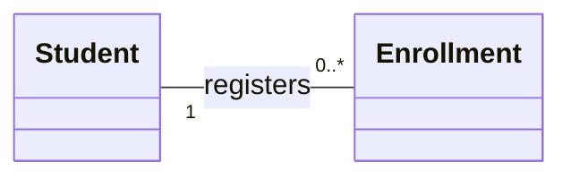
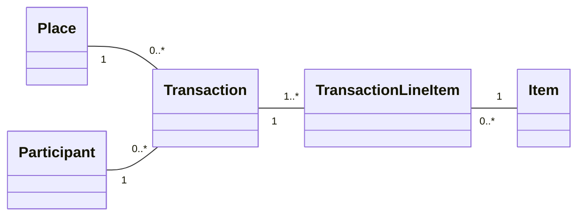

## Structural Modeling - 구조 모델링
Structural Modeling은 시스템을 구성하는 Objects와 객체간 Relationships를 식별하고 표현하는 모델링 과정이다.

시스템이 수행하는 기능보다는 시스템을 구성하는 데이터와 객체의 Objects의 구조를 중심으로 분석한다.

| 구분 | Functional | Structural |
| --- | ----------- | --------- |
| 핵심 질문 | 시스템은 무엇을 하는가? | 시스템은 무엇으로 구성되는가? |
| 중심 요소 | 기능, 행위, 흐름 | 클래스, 속성, 연산, 관계 |
| 대표 다이어그램 | Use Case, Activity | Class |
| 목적 | 기능적 요구사항 표현 | 시스템의 정적 구조 표현 |

## Classes, Attributes, Operations
객체지향 구조 모델링의 기본 구성 요소는 Class, Attribute, Operation 이다.

### Class
동일한 속성과 행위를 가진 객체를 생성하기 위한 템플릿

* Concrete Class: 직접 객체를 생성할 수 있는 구체 클래스
* Abstract Class: 공통적인 특성을 추상화한 클래스로, 직접 인스턴스를 생성하지 않는다.

예를들어 `Person`을 추상 클래스로 정의하고 `Customer`, `Employee`를 구체 클래수로 정의할 수 있다.

### Attribute
객체의 상태나 특성을 나타내는 정보

예를들어 `Student`는 `studentId`, `name`, `email` 등의 속성을 가진다.

모든 현실 세계의 특징을 넣을 필요는 없으며, 시스템의 목적과 관련된 속성만 포함해야 한다.

### Operation
객체가 수행할 수 있는 행동이나 기능을 의미

예를들어 `Student`가 수강 신청을 수행한다면 `registerModule()`이라는 연산을 가질 수 있다.

## Class Diagram
클래스와 클래스 사이의 관계를 나타내는 정적 구조 다이어그램이다.

기본 구조

```text
+----------------------------------------+
|                Student                 |
+----------------------------------------+
| - studentId: String                    |
| - name: String                         |
| - email: String                        |
+----------------------------------------+
| + register(): void                     |
| + getGrade(module: Module): Grade      |
+----------------------------------------+
```

하나의 클래스틑 세 부분으로 구성된다.
1. Class Name: 클래스 이름
2. Attributes: 클래스의 속성
3. Operations: 클래스의 기능

Attribute의 표기법
```text
[Visibility] attributeName: Type
```

Operation의 표기법
```text
[Visibility] operationName(parameter: Type): ReturnType
```

### Visibility
| 기호 | 접근 수준 | 의미 |
| --- | -------- | --- |
| `+` | Public | 외부에서 접근 가능 |
| `-` | Private | 클래스 내부에서 접근 가능 |
| `#` | Protected | 클래스 및 하위 클래스에서 접근 가능 |

### Relationships

| 관계 | 의미 | UML 표기 |
| :--- | :--- | :--- |
| Generalization | 상속, is-a 관계 | `───▷` 실선 + 빈 삼각형 |
| Realization | 인터페이스 구현 | `╌╌╌▷` 점선 + 빈 삼각형 |
| Association | 클래스 간 구조적 연결 | `───` 실선 |
| Aggregation | 약한 전체-부분 관계 | `───◇` 실선 + 빈 마름모 |
| Composition | 강한 전체-부분 관계 | `───◆` 실선 + 채운 마름모 |
| Dependency | 일시적인 사용 관계 | `╌╌╌>` 점선 + 열린 화살표 |

### Generalization - 일반화
예를들어 `Dog`는 `Animal` 의 한 종류다.

```text
Animal
  △
  │
 Dog
```

하위 클래스는 상위 클래스의 속성과 연산을 상속받고, 필요한 기능을 확장할 수 있다.

강의에선 상속이 클래스 간 Coupling을 만들어내므로 실제 is-a 관계에 사용하는 것이 좋다고 설명한다.

### Realization - 실체화
Realization은 클래스가 인터페이스에서 정의한 기능을 구현한다는 의미다.

```java
interface OnClickListener {
    void onClick();
}

class Button implements OnClickListener {
    public void onClick() {
        // Implementation
    }
}
```

> 실선이 아니라 점선과 빈 삼각형

### Association - 연관
Association은 두 클래스 사이에 존재하는 구조적인 관계를 표현한다. 강의에서는 한 클래스가 다른 클래스의 객체를 속성으로 참조하는 장기적인 관계를 예로 든다.

```java
class Employee {
    private Spouse spouse;
}
```
`Employee`가 `Spouse` 객체를 속성으로 참조하고 있으므로 두 클래스 사이에 Association 관계가 있다.

### Multiplicity - 다중성
한 클래스의 객체가 상대 클래스의 객체와 몇 개까지 연결될 수 있는지 표시한다.

* `1`: 정확히 하나
* `0..1`: 없거나 하나
* `0..*`: 없거나 여러 개
* `1..*`: 하나 이상
* `2..4`: 2개에서 4개
* `1,3,5`: 1개, 3개 또는 5개

예를 들어 다음 관계에서 학생 한 명은 여러 수강 신청 기록을 가질 수 있지만, 수강 신청 기록 하나는 학생 한 명에 속한다.



> 숫자가 적힌 쪽에 몇개의 객체가 연결될 수 있는지 읽는 것이 중요하다.

### Association Class - 연관 클래스
두 클래스의 관계 자체에 추가적인 속성이나 정보가 필요할 때 사용하는 클래스

강의에선 `Student`와 `Course`의 관계에 `Grade`라는 연관 클래스를 추가하는 예제를 다뤘다. 성적은 학생만의 속성도, 과목만의 속성도 아니라 특정 학생이 특정 과목을 수강한 관계에 대한 정보이기 때문

### Aggregation - 집합
전체-부분 관계 중에서 부분 객체가 전체 객체와 독립적으로 존재할 수 있는 관계를 나타낸다.

강의 예시는 `Team`과 `Player`다.
* 팀이 해체되어도 선수는 존재한다.
* 선수는 팀과 독립적인 생명주기를 가진다.
* 부분 객체가 다른 전체 객체와 공유될 수 있다.

> 전체 객체 쪽에 빈 마름모로 표시한다.

### Composition - 합성
Aggregation보다 강한 전체-부분 관계다.

부분 객체가 전체 객체에 강하게 종속되며, 전체 객체가 사라지면 부분 객체의 생명주기도 종료되는 관계를 표현한다.

강의 예시는 `House`와 `Room` 이다.
* 집이 철거되면 그 집을 구성하던 방도 사라진다.
* 하나의 방은 동시에 두 집에 소속될 수 없다.

> 전체 객체 쪽에 채운 마름모로 표시한다.

### Dependency - 의존
Dependency는 한 클래스가 다른 클래스를 일시적으로 사용하지만 장기적인 구조적 연결을 형성하지 않는 관계다.

일반적으로 다음 상황에서 발생한다.

* 메서드 매개변수로 사용
* 메서드 내부의 지역 변수로 사용
* 반환 타임 또는 메서드 호출을 통해 사용

> Association은 상대 객체를 속성으로 유지하는 구조적인 관계인 반면, Dependency는 기능 수행 중 상대 클래스를 사용하는 관계라는 점이 핵심

## Object Diagram
Object Diagram은 클래스 다이어그램에서 정의된 클래스를 기반으로, 특정 시점에 실제 생성된 Instance와 객체 사이의 연결을 표현하는 다이어그램이다.

```text
Class Diagram                         Object Diagram
+--------------------------+          +--------------------------+
|         Patient          |          |     johnDoe:Patient      |
+--------------------------+          +--------------------------+
| - name: String           |          | name = "John Doe"        |
| - age: Integer           |          | age = 40                 |
+--------------------------+          +--------------------------+
| + makeAppointment()      |
+--------------------------+
```

Object Diagram에서는 객체 이름과 클래스 이름을 `objectName:ClassName` 형태로 표시하고 **밑줄을** 사용한다. (아스키 특성상 밑줄 못그렸음)

## Creating Class Diagram
강의에서는 네 가지 접근 방법을 소개한다.

1. `Textual Analysis`: Use Case명세서의 문장을 분석
2. `Brainstorming`: 아이디어를 통해 후보 클래스 도출
3. `Common Object List`: 도메인에 일반적으로 존재하는 객체 탐색
4. `Patterns`: 기존에 검증된 객체 구조 재사용

### Textual Analysis
| 문장 요소 | 도출 가능한 요소 | 예시 |
| :--- | :--- | :--- |
| Common Noun (일반 명사) | Class | Customer, Order |
| Proper Noun (고유 명사) | Object Instance | ID가 123인 Customer |
| Collective Noun (집합 명사) | 집합을 나타내는 Class | Team, Players |
| Adjective (형용사) | Attribute | Red Car, Urgent Request |
| Doing/Transitive Verb (동사) | Operation | pay(), drive() |
| Being Verb (상태 표현) | 분류 관계 | John is a Customer |
| Having Verb (소유 표현) | Aggregation 또는 Association | Customer has an Account |
| Intransitive Verb (자동사) | 예외 상황 후보 | Payment fails |
| Adverb (부사) | 연산 또는 관계의 부가 속성 | temporarily, quickly |
| Conditional Phrase (조건절) | 조건, 대안 흐름, 예외 흐름 | If password is incorrect |

예를 들어 다음 Use Case 문장을 분석해 보자

> The Customer places an Order.
* `Customer` → Class 후보
* `Order` → Class 후보
* `places` → Operation 및 Relationship 후보

따라서 `Customer`, `Order` 클래스를 도출하고, 두 클래스가 주문을 생성하거나 연결되는 관계를 가지는지 검토할 수 있다.

중요한 것은 명사가 등장했다고 무조건 클래스가 되는 것은 아니라는 점이다. 최초에는 후보로 식별하고, 이후 모델 검토 과정에서 불필요한 클래스를 제거한다.

### Common Object List
비즈니스 도메인에서 일반적으로 존재하는 객체 유형을 참고해 클래스를 식별한다.

예를 들어 다음과 같은 객체가 후보가 된다.
* **물리적 사물:** Book, Desk
* **사건:** Meeting, Accident
* **역할:** Doctor, Patient
* **업무 거래:** Sales Transaction
* **기타:** 장소, 조직, 정책

### Brainstorming
여러 사람이 아이디어를 제안하여 초기 후보 클래스를 만드는 방법

### Patterns
반복적으로 발생하는 문제를 해결하기 위해 기존의 클래스 구조를 재사용하는 방법이다.

예를 들어 거래를 다루는 시스템에서 다음과 같은 구조를 활용할 수 있다.



## Example - Software Borrowing
학생이 PC Lab에서 소프트웨어 설치 매체를 일정 기간 대여하는 시스템의 Class Diagram을 작성해보자.

### Step 1. Class 식별

| Class | 주요 Attributes | 주요 Operations |
| :--- | :--- | :--- |
| Student | studentId, name | checkEligibility() |
| LabStaff | staffId, name | confirmLoan() |
| SoftwareProduct | productId, title | ― |
| SoftwareCopy | copyId, licenseKey, status | markBorrowed() |
| Loan | loanId, loanDate, dueDate | create(), calculateDueDate() |

> 각 SoftwareCopy는 고유한 License Key를 가진다는 조건이 있으므로, `SoftwareProduct`와 실제로 대여되는 `SoftwareCopy`를 구분하는 것이 적절하다.

### Step 2. Class 간 관계 식별
`SoftwareProduct`는 여러 `SoftwareCopy`를 가질 수 있으며, `Student`는 여러 `Loan` 기록을 가질 수 있다.

`Loan`은 하나의 `SoftwareCopy`를 대상으로 하고, `LabStaff`가 대여를 처리한다.

### Step 3. Diagram 작성

```text
classDiagram
direction TB
class Student {
  -String studentId
  -String name
  +checkEligibility() Boolean
}
class LabStaff {
  -String staffId
  +confirmLoan() void
}
class SoftwareProduct {
  -String productId
  -String title
}
class SoftwareCopy {
  -String copyId
  -String licenseKey
  -String status
  +markBorrowed() void
}
class Loan {
  -String loanId
  -Date loanDate
  -Date dueDate
  +calculateDueDate() Date
}
SoftwareProduct "1" -- "0..*" SoftwareCopy
Student "1" -- "0..*" Loan
LabStaff "1" -- "0..*" Loan
SoftwareCopy "1" -- "0..*" Loan
```

## Key point
| 질문 | 핵심 |
| :--- | :--- |
| Structural Model은 무엇인가? | 객체와 객체 간 관계를 표현하는 모델 |
| CRC Card의 목적은? | 클래스의 책임과 협력 관계를 식별 |
| Class Diagram은 무엇을 표현하는가? | 클래스, 속성, 연산, 관계 |
| Object Diagram과의 차이는? | 클래스 정의와 실제 인스턴스의 차이 |
| Generalization은? | is-a, 상속 관계 |
| Realization은? | 인터페이스 구현 관계 |
| Association은? | 구조적인 연결 관계 |
| Aggregation은? | 부분이 독립 가능한 전체-부분 관계 |
| Composition은? | 부분이 전체에 종속되는 강한 전체-부분 관계 |
| Dependency는? | 일시적인 사용 관계 |
| Textual Analysis란? | Use Case의 문장을 분석하여 클래스 후보 등을 도출 |
| Class Diagram은 어떻게 만드는가? | 후보 도출 → 책임 검토 → 작성 → 개선 → 패턴 적용 |

## Summary and Discussion
#### CRC Card는 클래스의 핵심 요소를 식별하고 정리하기 위한 도구다.
#### Class Diagram과 Object Diagram은 객체지향 시스템의 구조를 표현한다.
#### Class Diagram은 클래스와 클래스 간 관계를 표현하는 다이어그램이다.
#### Should all symbols and semantics be represented in a class diagram?
아니다. 모든 UML 기호와 의미를 하나의 Class Diagram에 표현할 필요는 없다.
#### First drawn class diagram is not changed, isn't it?
아니다. Class Diagram은 반복적인 검토와 수정을 통해 발전한다.