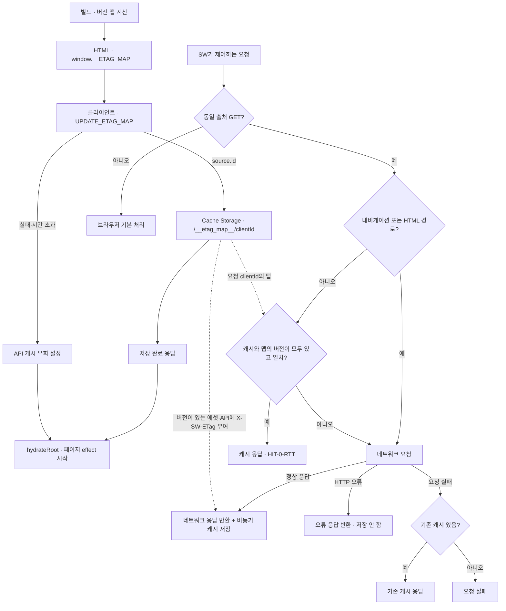
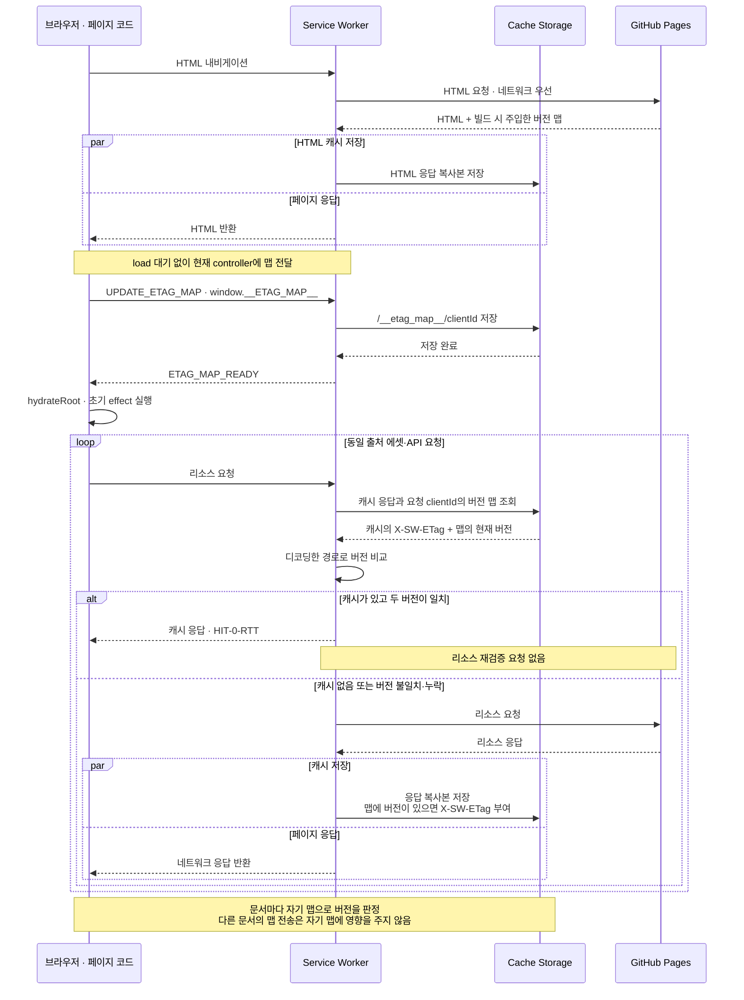

# Overview
[Rethinking Web Caching: An Optimization for the Latency-Constrained Internet](https://conferences.sigcomm.org/hotnets/2024/papers/hotnets24-124.pdf) (HotNets 2024)의 검증 토큰 선전달 아이디어를 정적 배포에 적용한다. 빌드에서 계산한 버전 맵을 HTML로 전달해 리소스별 재검증 왕복을 줄이며, HTML 내비게이션은 네트워크를 우선한다.

# Checkpoints
- 캐시 판단의 기준은 HTML에 포함된 빌드 시점의 버전 맵이며, 새 배포의 맵은 HTML을 다시 받을 때 반영한다. 글과 리소스가 배포 단위로 갱신되는 정적 블로그의 특성에 맞춘 정책이며, 실시간 데이터 변경에는 별도의 최신성 정책이 필요하다. 적용 전제는 [README](../README.md#overview)에 기록한다.
- 이 맵은 HTTP 서버의 `ETag` 응답 헤더가 아닌 자체 버전 정보다. [생성기](../scripts/inject-etag-map.js)는 JSON·HTML·MD를 MD5로 계산하고, 글 HTML은 원본 Markdown 해시를 사용한다. 나머지 에셋은 전체 파일 읽기와 해시 계산 비용을 줄이기 위해 `파일명-크기`를 사용한다. 이는 변경 감지 정확도와 빌드 비용 사이의 의도적인 트레이드오프이며, 같은 이름·크기의 내용 변경을 구분하지 못하는 제약을 수용한다. 이 제약은 현재 정책에서 미해결 결함으로 취급하지 않으며, [배포 갱신 테스트](testing.md#배포와-캐시-격리)도 해당 정책을 전제로 한다.
- 키는 디코딩된 URL 경로다. `/index.html`은 `/`, 다른 HTML은 확장자를 뺀 경로로 등록하며, `server/`와 `template.html`은 맵에서 제외한다. [Service Worker](../public/sw.js)도 조회 전에 `pathname`을 디코딩한다.
- 허용된 글 ID·태그의 `$&`, `$$` 같은 문자열도 맵 키의 일부다. HTML 삽입 과정에서 치환 토큰으로 해석하거나 스크립트 경계를 바꾸어서는 안 된다. [주입 스크립트 회귀 테스트](../server/inject-etag-map.test.ts)와 [태그 URL E2E](../tests/e2e/content-urls.spec.ts)에서 원문 키의 보존을 검증한다.
- 맵 전달을 `load`까지 미루면서 React를 먼저 시작하면 초기 effect의 JSON 요청이 이전 맵으로 처리될 수 있다. 나중에 맵만 갱신해도 이미 표시한 목록은 바뀌지 않으므로, 메시지 전송이 아니라 저장 완료 응답을 hydration의 선행 조건으로 삼는다. 재현 조건과 검증 범위는 [테스트 문서](testing.md#재현-조건과-판정)에 기록한다.
- [초기 동기화](../src/lib/serviceWorker.ts)는 버전 맵이 있는 프로덕션 문서에서 `load`를 기다리지 않고 SW를 등록한다. 현재 controller에 맵을 보내고, SW가 해당 문서의 맵 저장을 끝냈다는 MessageChannel 응답을 받은 뒤 [루트 hydration](../src/entry-client.tsx)을 시작한다. 재방문은 기존 controller와 바로 동기화하며 스크립트 업데이트 검사를 기다리지 않는다. 준비 중 controller가 교체되면 새 controller의 응답을 기다린다.
- 저장 확인은 해당 문서의 맵에 대한 확인이다. 다른 문서의 맵 재전송은 이 문서의 버전 판정에 영향을 주지 않아야 한다. 문서 식별은 브라우저가 제공하는 [메시지 발신 클라이언트](https://developer.mozilla.org/en-US/docs/Web/API/ExtendableMessageEvent/source)와 [fetch 요청 클라이언트](https://developer.mozilla.org/en-US/docs/Web/API/FetchEvent/clientId)를 기준으로 한다. URL이 같은 문서도 각자 다른 맵을 가질 수 있다.
- SW 종료 뒤에도 문서별 검증 기준을 복구할 수 있어야 하므로 맵을 Cache Storage에 보관한다. 종료된 문서와 이전 전역 맵은 정리 대상이며, 정리 실패가 유효한 맵의 저장 확인을 막아서는 안 된다. 클라이언트 ID나 해당 맵이 없는 요청은 버전 일치 판정을 생략하고 네트워크를 우선한다.
- 2초는 동기화 시작부터 controller 확보와 맵 저장 확인 응답까지의 전체 대기 제한이다. 최초 방문에는 SW 다운로드·설치의 네트워크 대기가 포함될 수 있고, 기존 controller가 있으면 주로 메시지 전달과 로컬 저장을 기다린다. 응답이 먼저 오면 즉시 진행하며, 리소스별 캐시 버전 비교는 이후 fetch 시점에 수행한다.
- 제어 SW 없이 등록이 거부되면 일반 요청으로 시작한다. 시간 초과·저장 실패 시에는 hydration을 진행하되 해당 문서의 동일 출처 GET `/api/` fetch에 요청마다 고유한 `__sw_bypass` query와 HTTP 재검증을 적용한다. 현재 SW는 이 요청을 저장·캐시 조회 없이 처리하며, ACK를 모르는 이전 SW도 URL이 달라 기존 응답을 재사용하지 못한다. 이 실패 경로의 API 요청에는 오프라인 캐시 fallback이 없다.
- hydration 이후 `controllerchange`에는 같은 문서의 맵을 다시 전달한다. SPA 이동으로 새 배포 맵을 받지는 않는다. hydration 전에 브라우저가 요청한 에셋의 순서는 이번 동기화로 보장하지 않는다.
- 응답 캐시는 URL별로 공유하며, 배포 경계에서 이전 문서가 새 배포의 응답을 받는 것을 허용한다. 이전 문서의 캐시 미스에 새 배포의 응답이 오면 그 문서 맵의 버전으로 저장될 수 있다. 이 동작은 정적 블로그의 배포 단위 갱신을 전제로 한다.
- 최초 방문에 에셋을 미리 캐시하지 않는다. SW가 제어하는 요청으로 응답과 `X-SW-ETag`가 저장된 뒤에야 버전 일치 시 `HIT-0-RTT` 응답이 가능하다. 맵에 버전이 없는 리소스는 이 경로로 반환하지 않는다.
- 네트워크 우선 대상은 내비게이션, `.html`, `/`, `/posts/` 경로다. `/api/posts/`는 버전 비교 대상이다. HTML에 맵 항목이 있어도 HTML 요청에서는 버전 비교를 생략한다.
- HTML 요청과 에셋·API 캐시 미스는 `cache: 'no-cache'`로 HTTP 캐시도 재검증한다. 새 맵의 버전에 이전 HTTP 캐시 본문이 저장되는 것을 방지하기 위한 정책이다. 2xx 응답만 저장하며 404·500은 그대로 반환한다. 정상 경로에서 네트워크 요청 자체가 실패하면 기존 캐시를 사용하므로 오프라인 응답은 오래된 버전일 수 있고, 캐시가 없으면 실패한다.
- Performance API의 `app:cache-sync`는 SW 준비·확인 응답 대기 시간과 결과 상태, `app:hydrate-start`는 hydration 호출 시점을 기록한다. 완료 시점이나 사용자 입력 지연을 직접 뜻하지 않는다.

# Diagrams
## 버전 맵 전달과 요청 처리 정책
빌드에서 만든 맵이 SW에 전달되는 경로와, 요청 종류·버전 일치·네트워크 실패에 따라 응답을 선택하는 기준을 보여준다.

## 재방문 시 캐시 조회와 갱신 순서
SW가 제어하는 온라인 재방문에서 React의 초기 effect 요청이 실행되는 순서다. 브라우저가 hydration 이전에 시작한 에셋 요청은 이 순서에 포함하지 않는다.

# Tests

[문서별 맵 테스트](../tests/cache/client-maps.spec.ts)는 이전 문서가 맵을 다시 보낸 뒤 새 문서의 목록 요청, SW 재시작 후 캐시 재사용, 맵 없는 문서의 네트워크 요청, 종료된 문서와 이전 전역 맵의 정리를 검증한다. [기존 배포 갱신 테스트](../tests/cache/refresh.spec.ts)는 문서별 맵을 조회해 첫 목록 응답과 캐시 버전의 근거를 기록한다. 실행 방법은 [테스트 문서](testing.md)를 따른다.
