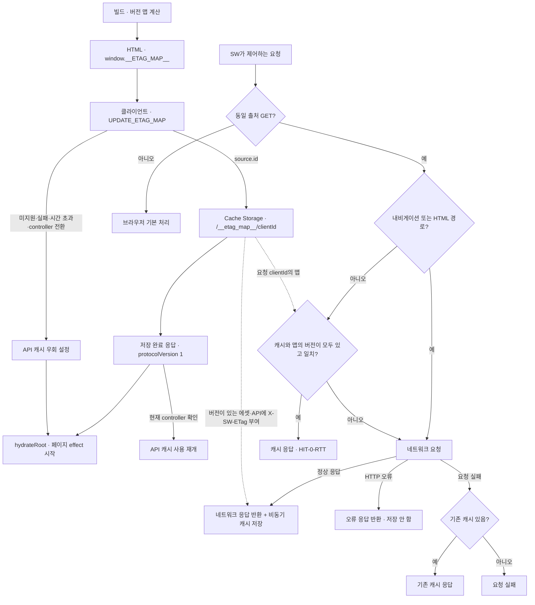
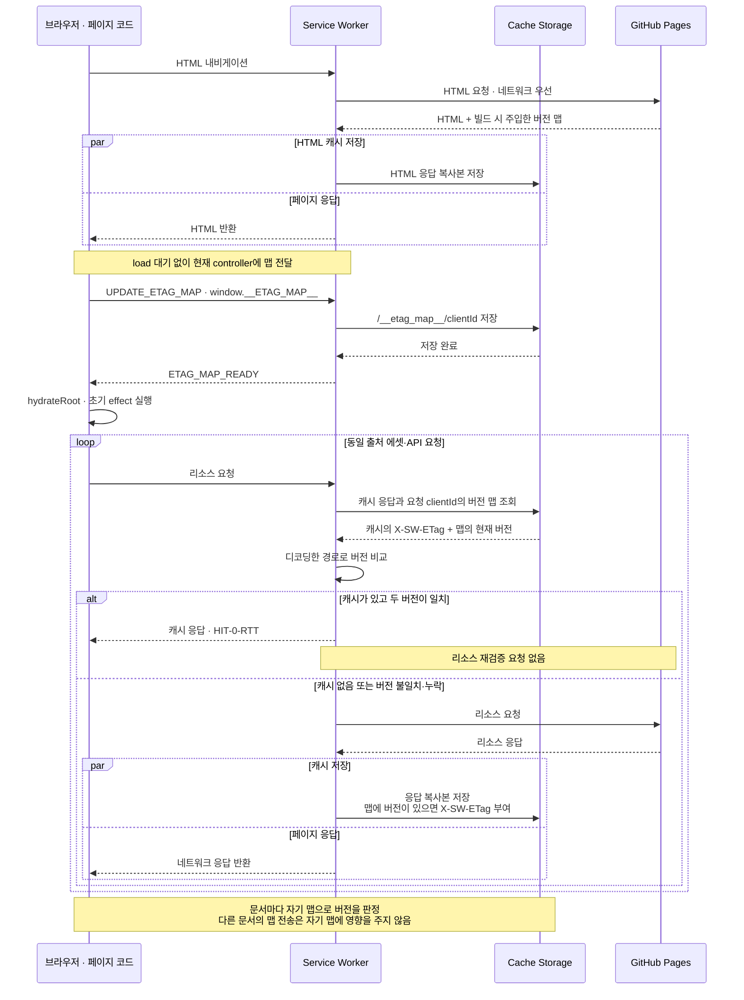

# Overview
[Rethinking Web Caching: An Optimization for the Latency-Constrained Internet](https://conferences.sigcomm.org/hotnets/2024/papers/hotnets24-124.pdf) (HotNets 2024)의 검증 토큰 선전달 아이디어를 정적 배포에 적용한다. 빌드에서 계산한 버전 맵을 HTML로 전달해 리소스별 재검증 왕복을 줄이며, HTML 내비게이션은 네트워크를 우선한다.

# Checkpoints

배포 단위의 최신성은 [설계 정책](design-decisions.md#설계-전제와-정책), 버전 판정·동기화 대기·배포 혼용의 비용은 [트레이드오프](design-decisions.md#수용한-트레이드오프), 캐시 적중과 실패·오프라인 동작은 [알려진 제약](design-decisions.md#지원-범위와-알려진-제약)을 따른다.

- 맵 키는 디코딩된 URL 경로다. `/index.html`은 `/`, 다른 HTML은 확장자를 뺀 경로로 등록하며 `server/`와 `template.html`은 제외한다. 생성기와 SW가 경로를 다르게 해석하면 버전 비교가 성립하지 않는다. [맵 생성](../scripts/inject-etag-map.js) · [Service Worker](../public/sw.js)
- `$&`, `$$`도 허용된 이름의 일부다. 맵 주입에서 치환 토큰으로 해석하거나 스크립트 경계를 바꾸지 않도록 원문 키를 보존한다. [주입 회귀 테스트](../server/inject-etag-map.test.ts) · [태그 URL E2E](../tests/e2e/content-urls.spec.ts)
- 맵 저장·조회는 URL이 아닌 브라우저의 클라이언트 ID로 연결한다. `UPDATE_ETAG_MAP`의 `event.source.id`와 fetch의 `event.clientId`가 같은 문서를 식별해야 하며, 같은 URL로 연 문서도 서로의 맵을 덮지 않아야 한다. [문서별 맵 테스트](../tests/cache/client-maps.spec.ts)
- `ETAG_MAP_READY`의 `protocolVersion: 1`은 문서별 맵 저장·조회 지원을 뜻한다. 버전 없는 ACK는 전역 맵 워커도 보낼 수 있으므로 준비 완료로 인정하지 않는다. `load`나 메시지 전송 완료가 아닌 Cache Storage 저장 완료를 확인하고, 준비 중 controller가 바뀌면 이전 controller의 ACK는 인정하지 않는다. [동기화 구현](../src/lib/serviceWorker.ts) · [업그레이드 테스트](../tests/cache/upgrade.spec.ts)
- API 우회의 `__sw_bypass`는 요청마다 고유해야 ACK를 모르는 이전 SW도 같은 URL의 응답을 재사용하지 못한다. 현재 SW와 [전역 맵 워커 fixture](../tests/fixtures/sw-global.js)는 해당 query를 제거해 네트워크로 전달하되 캐시 조회·저장을 생략한다. [초기화 실패 테스트](../tests/cache/bootstrap.spec.ts)
- SW 종료 뒤에도 판정 기준을 복구하도록 문서별 맵을 Cache Storage에 보관한다. 종료된 문서와 이전 전역 맵은 정리하되, 정리 실패가 유효한 맵의 저장 ACK를 막아서는 안 된다. 활성화 시에는 `tomato-etag-cache-`로 시작하는 블로그의 이전 캐시만 삭제해 같은 출처의 다른 앱 캐시를 보존한다. [Service Worker](../public/sw.js) · [활성화 회귀 테스트](../server/service-worker.test.ts)
- 내비게이션·`.html`·`/`·`/posts/`는 HTML의 네트워크 우선 경로다. `/api/posts/`는 글 URL과 이름이 비슷해도 에셋·API의 버전 비교 대상으로 유지한다. [요청 분기](../public/sw.js)

# Diagrams
## 버전 맵 전달과 요청 처리 정책
빌드에서 만든 맵이 SW에 전달되는 경로와, 요청 종류·버전 일치·네트워크 실패에 따라 응답을 선택하는 기준을 보여준다.

## 재방문 시 캐시 조회와 갱신 순서
SW가 제어하는 온라인 재방문에서 React의 초기 effect 요청이 실행되는 순서다. 브라우저가 hydration 이전에 시작한 에셋 요청은 이 순서에 포함하지 않는다.

# Tests

[문서별 맵 테스트](../tests/cache/client-maps.spec.ts)는 이전 문서가 맵을 다시 보낸 뒤 새 문서의 목록 요청, SW 재시작 후 캐시 재사용, 맵 없는 문서의 네트워크 요청, 종료된 문서와 이전 전역 맵의 정리를 검증한다. [기존 배포 갱신 테스트](../tests/cache/refresh.spec.ts)는 문서별 맵을 조회해 첫 목록 응답과 캐시 버전의 근거를 기록한다. 실행 방법은 [테스트 문서](testing.md)를 따른다.

[업그레이드 테스트](../tests/cache/upgrade.spec.ts)는 과거 전역 맵 워커를 실제로 설치한 Chromium에서 설치 지연·실패, 두 문서의 맵 재전송, controller 전환 중 저장 지연·시간 초과와 늦은 ACK, 전환 후 SW 재시작을 검증한다. 표시 목록·실제 ACK·응답 헤더와 Nginx 요청 수를 함께 확인한다.
