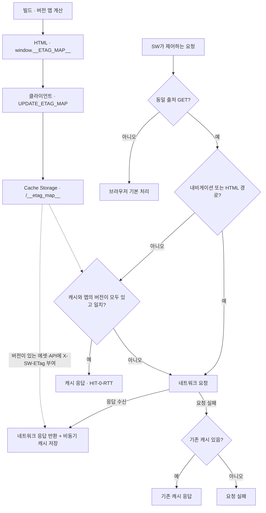
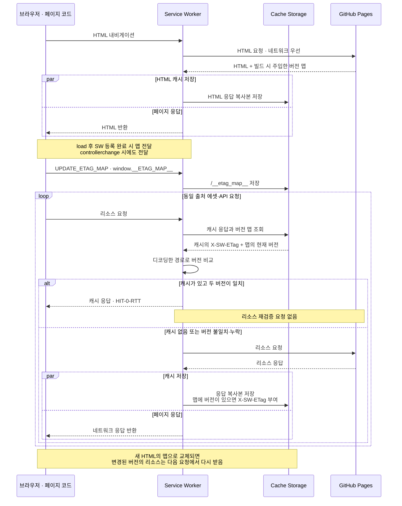

# Overview
[Rethinking Web Caching: An Optimization for the Latency-Constrained Internet](https://conferences.sigcomm.org/hotnets/2024/papers/hotnets24-124.pdf) (HotNets 2024)의 검증 토큰 선전달 아이디어를 정적 배포에 적용한다. 빌드에서 계산한 버전 맵을 HTML로 전달해 리소스별 재검증 왕복을 줄이며, HTML 내비게이션은 네트워크를 우선한다.

# Checkpoint
- 이 맵은 HTTP 서버의 `ETag` 응답 헤더가 아닌 자체 버전 정보다. [생성기](../scripts/inject-etag-map.js)는 JSON·HTML·MD를 MD5로 계산하고, 글 HTML은 원본 Markdown 해시를 사용한다. 나머지 에셋은 `파일명-크기`이므로 같은 이름·크기의 내용 변경을 구분하지 못한다.
- 키는 디코딩된 URL 경로다. `/index.html`은 `/`, 다른 HTML은 확장자를 뺀 경로로 등록하며, `server/`와 `template.html`은 맵에서 제외한다. [Service Worker](../public/sw.js)도 조회 전에 `pathname`을 디코딩한다.
- [클라이언트 진입점](../src/entry-client.tsx)은 프로덕션에서만 SW를 등록한다. 페이지 load 후 등록 완료 시점과 `controllerchange`에 `window.__ETAG_MAP__`을 전달하고, SW는 `/__etag_map__`에 저장한다. SPA 이동만으로 새 맵을 받지는 않는다.
- 최초 방문에 에셋을 미리 캐시하지 않는다. SW가 제어하는 요청으로 응답과 `X-SW-ETag`가 저장된 뒤에야 버전 일치 시 `HIT-0-RTT` 응답이 가능하다. 맵에 버전이 없는 리소스는 이 경로로 반환하지 않는다.
- 네트워크 우선 대상은 내비게이션, `.html`, `/`, `/posts/` 경로다. `/api/posts/`는 버전 비교 대상이다. HTML에 맵 항목이 있어도 HTML 요청에서는 버전 비교를 생략한다.
- 네트워크 요청이 실패하면 기존 캐시를 사용하므로 오프라인 응답은 오래된 버전일 수 있다. 캐시가 없는 요청은 실패하며, HTTP 오류 상태는 별도로 검사하지 않아 404·500 응답만으로 캐시 fallback이 실행되지는 않는다.

# Architecture
## 버전 맵 전달과 요청 처리 정책
빌드에서 만든 맵이 SW에 전달되는 경로와, 요청 종류·버전 일치·네트워크 실패에 따라 응답을 선택하는 기준을 보여준다.

## 재방문 시 캐시 조회와 갱신 순서
SW가 제어하는 온라인 재방문의 흐름이다. 리소스 요청은 맵 저장 이후를 예로 들며, 실제 초기 로딩 요청과 맵 전달은 동기화되어 있지 않다.

