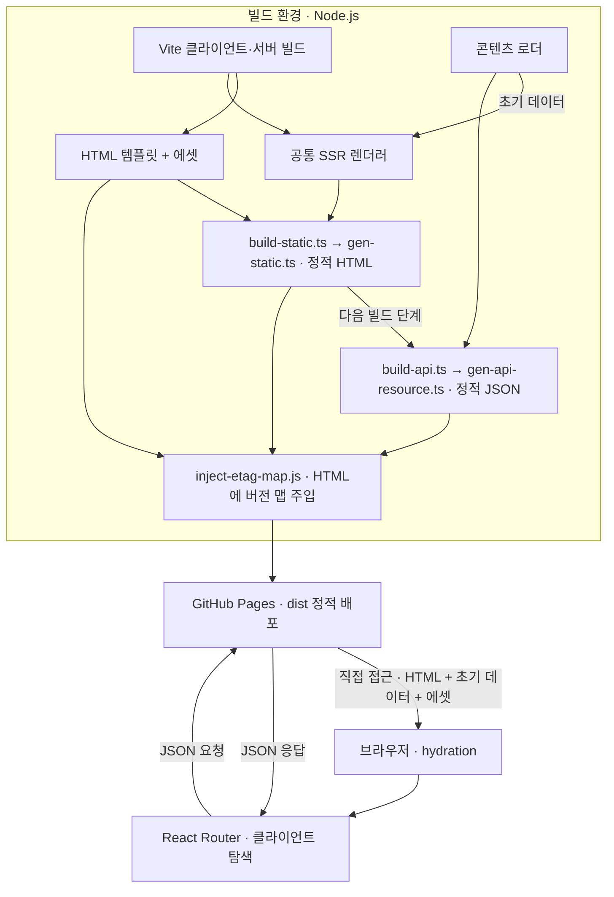

# Overview
공통 SSR 렌더러를 빌드 시점에 재사용해 HTML을 만들고, 클라이언트 요청에 사용할 JSON을 에셋으로 생성한다.

# Checkpoints

SSR과의 초기 데이터 차이는 [설계 정책](design-decisions.md#설계-전제와-정책), 빌드·JSON 비용은 [트레이드오프](design-decisions.md#수용한-트레이드오프), 콘텐츠 이름과 메타데이터의 허용 범위는 [알려진 제약](design-decisions.md#지원-범위와-알려진-제약)을 따른다. 로컬 서빙의 보장 범위는 [검증 범위](design-decisions.md#검증-범위와-해석)에서 관리한다.

- 생성 모듈의 import는 콘텐츠나 산출물 읽기를 시작하지 않는다. 실행 진입점이 입력을 준비하고 생성 함수는 전달받은 데이터·렌더러·출력 경로를 사용해야 임시 입력으로 격리 검증할 수 있다. [HTML 생성](../server/gen-static.ts) · [JSON 생성](../server/gen-api-resource.ts) · [생성기 테스트](testing.md#서버-유닛-테스트)
- 새 페이지를 링크로 노출하면 정적 HTML 생성 대상에도 포함해야 한다. 라우터만 추가해 SPA 탐색이 성공해도 직접 접속에 필요한 파일은 생기지 않는다. [HTML 생성 대상](../server/gen-static.ts) · [정적 라우팅 테스트](../tests/e2e/static-site.spec.ts)
- 초기 HTML과 JSON 응답은 [공유 데이터 계약](../shared/common.ts)을 사용한다. Markdown 파서의 반환 타입을 브라우저 계약으로 사용하지 않으며, [콘텐츠 로더](../server/utils.ts)의 런타임 검증을 통과한 메타데이터만 해당 타입으로 취급한다.
- 목록의 `{ len, data }` 계약에서 글이 없어도 홈·검색의 첫 요청은 빈 성공 응답이어야 한다. 전체 태그 집계는 `initialData.tags`로 전달하므로 태그별 API에 집계용 예약 경로를 두지 않는다. `all-tags`도 일반 태그다. [빈 목록 생성 테스트](../server/gen-api-resource.test.ts) · [태그 API 테스트](../server/server.test.ts)

# Diagrams
## 정적 산출물 생성과 배포 후 사용
빌드에서 HTML·JSON·에셋을 생성해 GitHub Pages에 배포하고, 브라우저가 각 산출물을 사용하는 흐름을 보여준다.

# Tests

[HTML 생성기 테스트](../server/gen-static.test.ts)는 경로별 초기 데이터와 테스트용 렌더러를 사용해 템플릿 보관·파일 경로·실패 전달을 검사한다. [JSON 생성기 테스트](../server/gen-api-resource.test.ts)는 글 상세 데이터·페이지 경계·태그별 목록과 파일 저장 실패를 검사한다. 파일 저장까지 포함하는 테스트는 임시 디렉터리에서 실행하며, 실제 렌더러를 연결한 브라우저 동작은 [기존 E2E](testing.md)에서 검증한다.
