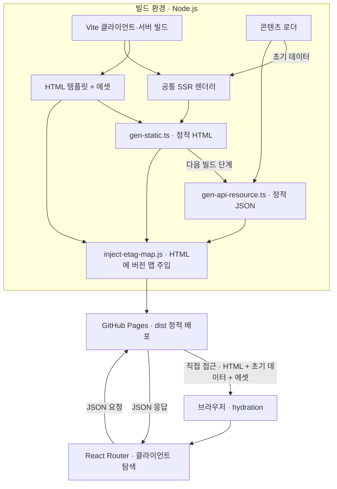

# Overview
빠른 개발용 SSR의 렌더러를 빌드 시점에 재사용해 HTML을 만들고, 클라이언트 요청에 사용할 JSON을 에셋으로 생성한다. 요청마다 렌더링하는 SSR 환경과 동작이 완전히 같지는 않으며, 최종 서비스는 Express 없이 GitHub Pages에서 정적 HTML·JSON·에셋으로 제공한다.

# Checkpoint
- [HTML 생성 대상](../server/gen-static.ts)은 `/`, `/search`, `/tags`, `/posts/<글 ID>`다. 루트는 `index.html`, 나머지는 `<경로>.html`로 저장한다. React 라우트에 있는 `/license`는 생성 대상에 없다.
- 글 ID는 연도를 제외한 폴더명이다. HTML·JSON·클라이언트 링크·ETag 키가 같은 글을 가리켜야 하며, HTML 생성기의 `?` → `_`, `%20` → `-` 치환은 다른 경로 생성 코드에 공통 적용되지 않는다.
- [정적 API 생성기](../server/gen-api-resource.ts)는 글 상세, 페이지별 최근 글, 태그별 글 목록 JSON을 만든다. 목록 계약은 `{ len, data }`이며, 최근 글은 페이지 단위로 생성하고 태그별 목록은 브라우저에서 페이지를 나눈다.
- Express의 `/api/tags/all-tags.json`에 대응하는 전체 태그 집계 파일은 별도로 생성하지 않는다. 현재 태그 화면은 HTML에 주입된 `initialData.tags`를 사용한다.
- 빌드는 클라이언트·서버 번들 → HTML → JSON → [ETag 맵 주입](ETag-Map.md) 순서다. 일부 단계만 실행하면 최신 배포 산출물이 완성되지 않는다. [배포 워크플로](../.github/workflows/deploy.yml)는 `npm run build` 후 `dist/`를 업로드한다.
- `npm run start:ssg`는 산출물의 로컬 확인용이다. 서버별 URL 해석이 다를 수 있으므로 확장자 없는 직접 접근과 새로고침은 GitHub Pages에서도 확인해야 한다. SPA 내부 이동 성공만으로 해당 HTML 파일의 존재를 판단할 수 없다.

# Diagram
## 정적 산출물 생성과 배포 후 사용
빌드에서 HTML·JSON·에셋을 생성해 GitHub Pages에 배포하고, 브라우저가 각 산출물을 사용하는 흐름을 보여준다.

