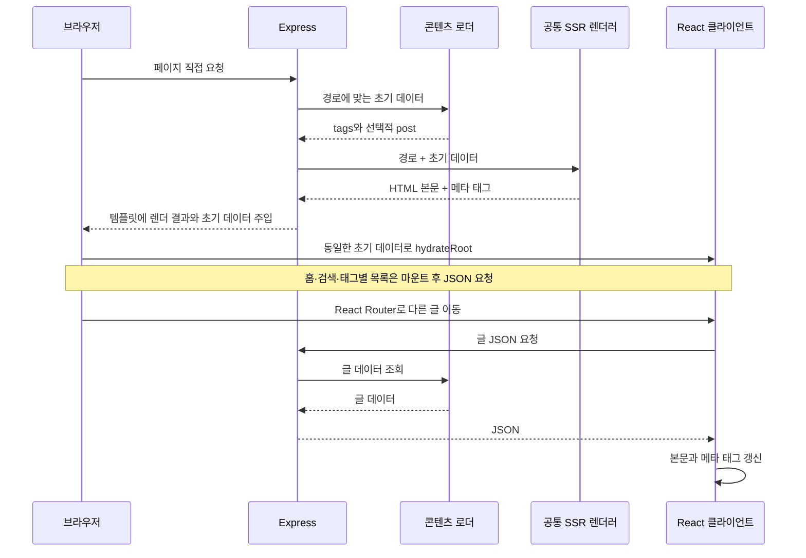

# Overview
빠른 개발을 위해 Express에서 요청 시점에 React를 렌더링하고, 초기 데이터를 담은 HTML을 브라우저의 hydration으로 연결한다.

# Checkpoints

- 글 주소의 ID는 콘텐츠 로딩 전에 [공통 이름 정책](../server/utils.ts)으로 검사하며, 하위 경로·금지 이름은 404로 처리한다. URL 입력 오류와 실제 콘텐츠의 검증 실패를 구분해, 콘텐츠 오류가 404로 숨겨지지 않도록 한다. [HTTP 계약 테스트](../server/server.test.ts)가 이 경계를 검증한다.
- Express 실행 중 콘텐츠를 추가·변경·삭제해도 이미 읽은 최근 글·태그별 목록은 갱신되지 않을 수 있다. 상세 조회와 HTML의 태그 집계에는 변경이 반영되어 목록 API와 차이가 생길 수 있다. 개발·유지보수 단순성을 위해 목록 캐시 무효화는 구현하지 않는 제약으로 수용하며, 변경 후 서버를 재시작한다. [Docker 개발 흐름](../compose.dev.yaml)은 콘텐츠 변경 시 동기화와 재시작을 수행한다. 이 제약은 빌드마다 JSON을 생성하는 [SSG 배포](SSG.md)의 갱신 정책과 구분한다.
- `image`가 있는 글은 직접 SSR한 메타데이터에 해당 이미지가 들어가지만, SPA 탐색에서는 기본 이미지로 바뀐다. [대표 이미지 미지원 정책](../README.md#checkpoints)에 따라 두 경로의 이미지 메타데이터 불일치를 수정하지 않는 제약으로 수용한다. 본문의 이미지 표시와는 별개이며, [SPA 메타 갱신](../src/pages/Post.tsx)과 [SSR 메타 생성](../src/entry-server.tsx)의 차이를 기능 지원으로 오인하지 않는다.

- [공통 렌더러](../src/entry-server.tsx)는 `renderToPipeableStream`의 결과를 문자열로 모아 반환한다. Express의 HTTP 응답에 직접 스트리밍하지 않는다.
- [초기 데이터](../server/utils.ts)는 모든 페이지의 태그 집계와 글 상세의 `post`를 포함한다. 홈 목록·검색 데이터·선택한 태그의 글 목록은 브라우저에서 JSON을 요청하므로 전체 화면이 서버에서 완성되지는 않는다.
- 콘텐츠 조회·Vite 템플릿 변환·메타데이터와 canonical URL은 쿼리를 제외한 경로를 기준으로 한다. 태그 선택과 페이지 번호를 유지하기 위해 React Router에는 쿼리를 포함한 URL을 전달한다.
- 요청 경로의 기준은 마운트 전 URL이다. Express 미들웨어에서는 `req.path`에서 마운트 경로가 제외되므로 `req.originalUrl`에서 쿼리를 분리한 뒤 경로만 디코딩한다. 한글·공백이 포함된 글 ID와 쿼리 문자열은 서로 다른 경계에서 처리해야 한다. 근거는 [Express 요청 URL 계약](https://expressjs.com/en/5x/api/request/#reqoriginalurl)이다.
- 태그는 쿼리 값과 API 경로의 인코딩 규칙을 구분한다. 글 ID는 원래 pathname에서 한 번 디코딩해 사용한다. 라우터의 매개변수는 리터럴 `%2F`까지 `/`로 바꿀 수 있으므로 [URL 회귀 테스트](../tests/e2e/content-urls.spec.ts)에서 원문 ID·상세 API·canonical의 일치를 확인한다.
- 글 링크는 기존 한글·공백·`&`·쉼표의 pathname 표기를 유지한다. [Giscus의 pathname 매핑](https://github.com/giscus/giscus/blob/main/client.ts)은 URL 표기를 댓글 검색어로 사용하므로 불필요한 추가 인코딩으로 기존 댓글 연결이 달라지지 않도록 한다. `#`와 `%`는 URL 경계를 보존하도록 이스케이프한다.
- [Mount Context](../src/context/Mount.tsx)는 초기 렌더링과 이후 탐색을 구분한다. 글 상세는 처음에는 주입 데이터를 사용하고, 이후에는 API를 요청한다. 메타 태그도 초기 HTML 생성과 클라이언트 갱신 경로가 나뉜다.
- 초기 메타 태그에 들어가는 제목과 설명은 HTML이 아닌 텍스트다. [메타 생성 함수](../server/meta.ts)를 React 렌더링과 분리해 [태그·속성 경계 보존 테스트](../tests/e2e/metadata.spec.ts)를 직접 적용한다.
- [HTML 삽입](../server/utils.ts)은 원본 템플릿의 삽입 지점만 처리해야 한다. 본문 속 같은 표식과 치환 토큰은 원문으로 보존하고, 초기 JSON은 스크립트 경계를 닫지 않으면서 동일한 데이터로 복원되어야 한다. `__proto__` 같은 태그도 데이터 키이므로 JavaScript 객체 리터럴의 특수 속성 의미를 적용해서는 안 된다. [초기 데이터 회귀 테스트](../server/utils.test.ts)와 [SSR 통합 테스트](../server/server.test.ts)가 복원 경계를 검증한다.
- 페이지 이동이나 화면 이탈 뒤에는 이전 요청이 본문·메타데이터·로딩 상태를 갱신할 수 없다. 네트워크 취소 이후에도 JSON 처리 결과가 도착할 수 있으므로 [요청 수명 회귀 테스트](../tests/e2e/request-failures.spec.ts)의 두 경계를 함께 유지한다.
- 글 상세의 HTTP·네트워크·JSON 해석 실패는 오류 안내와 재시도로 이어진다. 10초는 SPA 탐색과 재시도에서 상세 JSON 응답과 본문 읽기를 기다리는 사용자 대기 상한이다. 시간 초과는 안내 대상이며, 페이지 이동에 따른 취소는 이전 요청의 결과를 무시한다. 이전 요청의 타이머가 다음 글이나 재시도의 상태를 바꾸어서는 안 된다.
- 홈·태그 목록도 현재 요청의 실패와 10초 대기 초과를 안내하고 같은 페이지·태그를 재시도할 수 있어야 한다. 이전 목록은 새 조건의 결과처럼 표시하지 않으며, 홈의 이미 확인한 페이지 링크는 요청 중이나 실패 후에도 유지한다. 태그를 해제하거나 화면을 떠나는 취소는 오류 안내 대상이 아니다. 응답·JSON 처리 대기와 요청 교체의 경계는 [요청 실패 E2E](../tests/e2e/request-failures.spec.ts)로 보호한다.
- [검색](../src/pages/Search.tsx)은 전체 목록 준비를 완료 조건으로 삼는다. 일부 요청이 실패하면 불완전한 자료로 검색을 활성화하지 않고 오류를 안내한다.
- 검색의 각 목록 요청도 응답·JSON 처리에 10초 대기 상한을 적용한다. 시간 초과 이후 늦게 완료된 자료로 입력을 활성화해서는 안 된다. [검색 요청 실패 테스트](../tests/e2e/request-failures.spec.ts)가 이 경계를 검증한다.
- 메타데이터의 빈 제목은 허용하되 목록·글 제목은 ID로 대체한다. 직접 접속과 SPA 탐색의 문서 제목도 같은 기준을 따른다. [SSR 통합 테스트](../server/server.test.ts)와 [요청 E2E](../tests/e2e/request-failures.spec.ts)에서 빈 제목의 본문 로딩 완료를 확인한다.
- 테마는 [HTML 초기 스크립트](../index.html)에서 복원하고 테마 버튼은 마운트 후 표시한다. Markdown·Giscus는 지연 로딩하며, Mermaid의 SVG 생성은 브라우저 effect에서 수행한다.
- 버전 맵이 포함된 프로덕션 HTML은 [클라이언트 진입점](../src/entry-client.tsx)에서 SW의 맵 저장 확인 뒤 hydration한다. 초기 HTML은 먼저 표시되지만 React 이벤트와 effect의 JSON 요청은 이 준비가 끝난 뒤 시작한다. 개발 환경은 이 대기를 생략하며, 실패·시간 제한은 [캐시 정책](ETag-Map.md)을 따른다.
- `npm run dev`는 Vite 미들웨어를 사용하는 SSR 환경이다. `npm run start:ssr`도 Express가 필요하므로 [SSG 배포](SSG.md)의 동작 검증을 대신하지 않는다.
- 존재하지 않는 글·태그·목록 페이지와 생성 대상 밖의 경로는 SSR에서도 404로 처리한다. 잘못된 목록 번호를 다른 페이지로 해석하거나 알 수 없는 API에 HTML 성공 응답을 제공해서는 안 된다. [HTTP 계약 테스트](../server/server.test.ts)가 정적 배포와의 경계를 검증한다.

# Diagrams

## 페이지 요청과 클라이언트 탐색

Express 환경에서 직접 URL 접근으로 HTML을 받는 과정과, hydration 이후 다른 글로 이동할 때 JSON을 요청하는 순서를 보여준다.

# Tests

[콘텐츠 로딩 유닛 테스트](../server/utils.test.ts)는 `posts/` 경로와 다른 이름에 포함된 `posts` 부분 문자열을 구분한다. 쿼리 처리의 실제 동작은 테스트용 글을 사용하는 Express 개발 SSR에서 원본 HTML의 본문·메타데이터와 hydration 후 태그 선택·페이지 번호를 함께 확인한다.

[요청 실패 E2E](../tests/e2e/request-failures.spec.ts)는 글 상세·홈·태그 목록의 실패 안내와 재시도, 응답·JSON 결과 전달 지연에 대한 시간 초과, 요청 교체 후 이전 타이머와 응답의 영향을 검사한다. 빈 목록 성공은 실패와 구분하고, 홈의 페이지 변경 중에는 이전 목록을 표시하지 않아야 한다. 시간 경과는 [Playwright Clock](https://playwright.dev/docs/clock)으로 제어한다. [정적 페이지 E2E](../tests/e2e/static-site.spec.ts)는 초기 데이터로 직접 접속하는 경로와 코드 블록·수식·Mermaid 렌더링을 확인한다.
