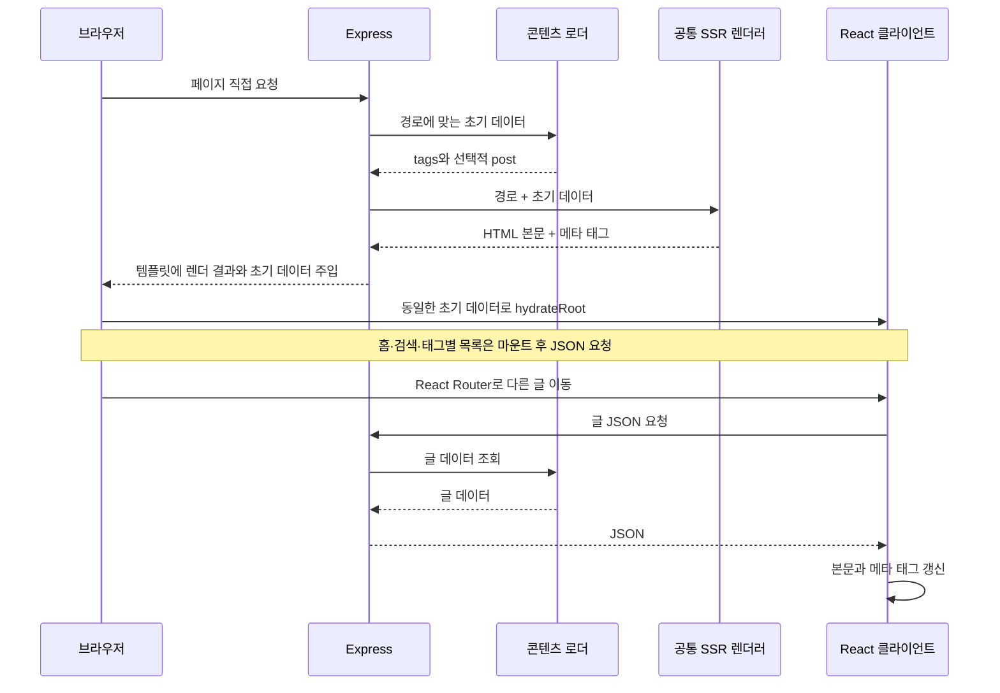

# Overview
빠른 개발을 위해 Express에서 요청 시점에 React를 렌더링하고, 초기 데이터를 담은 HTML을 브라우저의 hydration으로 연결한다.

# Checkpoints

운영 전제와 환경별 차이는 [설계 정책](design-decisions.md#설계-전제와-정책), 목록 캐시와 JSON 요청 비용은 [트레이드오프](design-decisions.md#수용한-트레이드오프), 기능 지원과 요청 실패 처리는 [알려진 제약](design-decisions.md#지원-범위와-알려진-제약)을 따른다.

- 요청 경로는 마운트 전 URL인 `req.originalUrl`에서 쿼리를 분리한 뒤 한 번 디코딩한다. `req.path`는 마운트 경로를 제외하므로 콘텐츠 조회 기준으로 혼용하지 않는다. 콘텐츠 조회·Vite 템플릿 변환·canonical은 pathname을 사용하고, 태그 선택과 페이지 번호를 유지할 React Router에는 쿼리 포함 URL을 전달한다. [서버 진입점](../server/server.ts) · [HTTP 계약 테스트](../server/server.test.ts)
- 글 ID는 원래 pathname에서 한 번 디코딩한다. 라우터 매개변수는 리터럴 `%2F`까지 `/`로 바꿀 수 있으므로 원문 ID·상세 API·canonical을 같은 기준으로 유지한다. 태그 쿼리 값과 API 경로도 서로 다른 URL 경계다. [글 화면](../src/pages/Post.tsx) · [URL 회귀 테스트](../tests/e2e/content-urls.spec.ts)
- 첫 클라이언트 렌더는 서버가 주입한 데이터와 같아야 한다. [Mount Context](../src/context/Mount.tsx)로 초기 글 데이터·메타데이터 사용과 이후 API 탐색을 구분하며, 태그의 `initialData.selectedTag`도 마운트 전에는 URL에서 다시 계산하지 않는다. [태그 화면](../src/pages/Tag.tsx) · [SSR 통합 테스트](../server/server.test.ts)
- 메타데이터의 제목과 설명은 HTML이 아닌 텍스트다. React 외부에서 만드는 메타 태그에도 속성·태그 경계를 보존해야 하므로 [메타 생성 함수](../server/meta.ts)를 별도로 검증한다. [DOM 경계 테스트](../tests/e2e/metadata.spec.ts)
- HTML 삽입은 원본 템플릿의 삽입 지점만 처리한다. 본문 속 같은 표식과 치환 토큰은 원문을 보존하고, 초기 JSON은 스크립트 경계를 닫지 않으면서 같은 데이터로 복원되어야 한다. `__proto__` 같은 태그도 데이터 키이므로 객체 리터럴의 특수 속성 의미를 적용하지 않는다. [HTML 삽입](../server/utils.ts) · [직렬화 회귀 테스트](../server/utils.test.ts)

# Diagrams

## 페이지 요청과 클라이언트 탐색

Express 환경에서 직접 URL 접근으로 HTML을 받는 과정과, hydration 이후 다른 글로 이동할 때 JSON을 요청하는 순서를 보여준다.

# Tests

[콘텐츠 로딩 유닛 테스트](../server/utils.test.ts)는 `posts/` 경로와 다른 이름에 포함된 `posts` 부분 문자열을 구분한다. 쿼리 처리의 실제 동작은 테스트용 글을 사용하는 Express 개발 SSR에서 원본 HTML의 본문·메타데이터와 hydration 후 태그 선택·페이지 번호를 함께 확인한다.

[요청 실패 E2E](../tests/e2e/request-failures.spec.ts)는 글 상세·홈·태그 목록의 실패 안내와 재시도, 응답·JSON 결과 전달 지연에 대한 시간 초과, 요청 교체 후 이전 타이머와 응답의 영향을 검사한다. 빈 목록 성공은 실패와 구분하고, 홈의 페이지 변경 중에는 이전 목록을 표시하지 않아야 한다. 시간 경과는 [Playwright Clock](https://playwright.dev/docs/clock)으로 제어한다. [정적 페이지 E2E](../tests/e2e/static-site.spec.ts)는 초기 데이터로 직접 접속하는 경로와 코드 블록·수식·Mermaid 렌더링을 확인한다.
