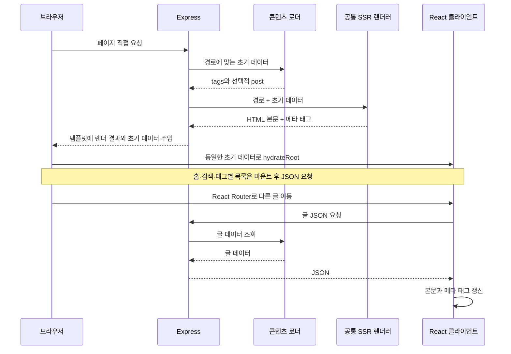

# Overview
빠른 개발을 위해 Express에서 요청 시점에 React를 렌더링하고, 초기 데이터를 담은 HTML을 브라우저의 hydration으로 연결한다.

# Checkpoints

- [공통 렌더러](../src/entry-server.tsx)는 `renderToPipeableStream`의 결과를 문자열로 모아 반환한다. Express의 HTTP 응답에 직접 스트리밍하지 않는다.
- [초기 데이터](../server/utils.ts)는 모든 페이지의 태그 집계와 글 상세의 `post`를 포함한다. 홈 목록·검색 데이터·선택한 태그의 글 목록은 브라우저에서 JSON을 요청하므로 전체 화면이 서버에서 완성되지는 않는다.
- [Mount Context](../src/context/Mount.tsx)는 초기 렌더링과 이후 탐색을 구분한다. 글 상세는 처음에는 주입 데이터를 사용하고, 이후에는 API를 요청한다. 메타 태그도 초기 HTML 생성과 클라이언트 갱신 경로가 나뉜다.
- 초기 메타 태그에 들어가는 제목과 설명은 HTML이 아닌 텍스트다. [메타 생성 함수](../server/meta.ts)를 React 렌더링과 분리해 [태그·속성 경계 보존 테스트](../tests/e2e/metadata.spec.ts)를 직접 적용한다.
- [HTML 삽입](../server/utils.ts)은 원본 템플릿의 삽입 지점만 처리해야 한다. 본문 속 같은 표식과 치환 토큰은 원문으로 보존하고, 초기 JSON은 스크립트 경계를 닫지 않으면서 동일한 데이터로 복원되어야 한다.
- 페이지 이동이나 화면 이탈 뒤에는 이전 요청이 본문·메타데이터·로딩 상태를 갱신할 수 없다. 네트워크 취소 이후에도 JSON 처리 결과가 도착할 수 있으므로 [요청 수명 회귀 테스트](../tests/e2e/request-failures.spec.ts)의 두 경계를 함께 유지한다.
- 글 상세의 HTTP·네트워크·JSON 해석 실패는 오류 안내와 재시도로 이어진다. 10초는 SPA 탐색과 재시도에서 상세 JSON 응답과 본문 읽기를 기다리는 사용자 대기 상한이다. 시간 초과는 안내 대상이며, 페이지 이동에 따른 취소는 이전 요청의 결과를 무시한다. 이전 요청의 타이머가 다음 글이나 재시도의 상태를 바꾸어서는 안 된다.
- [검색](../src/pages/Search.tsx)은 전체 목록 준비를 완료 조건으로 삼는다. 일부 요청이 실패하면 불완전한 자료로 검색을 활성화하지 않고 오류를 안내한다.
- 테마는 [HTML 초기 스크립트](../index.html)에서 복원하고 테마 버튼은 마운트 후 표시한다. Markdown·Giscus는 지연 로딩하며, Mermaid의 SVG 생성은 브라우저 effect에서 수행한다.
- 버전 맵이 포함된 프로덕션 HTML은 [클라이언트 진입점](../src/entry-client.tsx)에서 SW의 맵 저장 확인 뒤 hydration한다. 초기 HTML은 먼저 표시되지만 React 이벤트와 effect의 JSON 요청은 이 준비가 끝난 뒤 시작한다. 개발 환경은 이 대기를 생략하며, 실패·시간 제한은 [캐시 정책](ETag-Map.md)을 따른다.
- `npm run dev`는 Vite 미들웨어를 사용하는 SSR 환경이다. `npm run start:ssr`도 Express가 필요하므로 [SSG 배포](SSG.md)의 동작 검증을 대신하지 않는다.

# Diagrams

## 페이지 요청과 클라이언트 탐색

Express 환경에서 직접 URL 접근으로 HTML을 받는 과정과, hydration 이후 다른 글로 이동할 때 JSON을 요청하는 순서를 보여준다.

# Tests

[요청 실패 E2E](../tests/e2e/request-failures.spec.ts)는 글 상세 실패 안내와 재시도, 응답·JSON 결과 전달 지연에 대한 시간 초과, 글 이동 후 이전 타이머와 응답의 영향을 검사한다. 시간 경과는 [Playwright Clock](https://playwright.dev/docs/clock)으로 제어한다. [정적 페이지 E2E](../tests/e2e/static-site.spec.ts)는 초기 데이터로 직접 접속하는 경로와 코드 블록·수식·Mermaid 렌더링을 확인한다.
