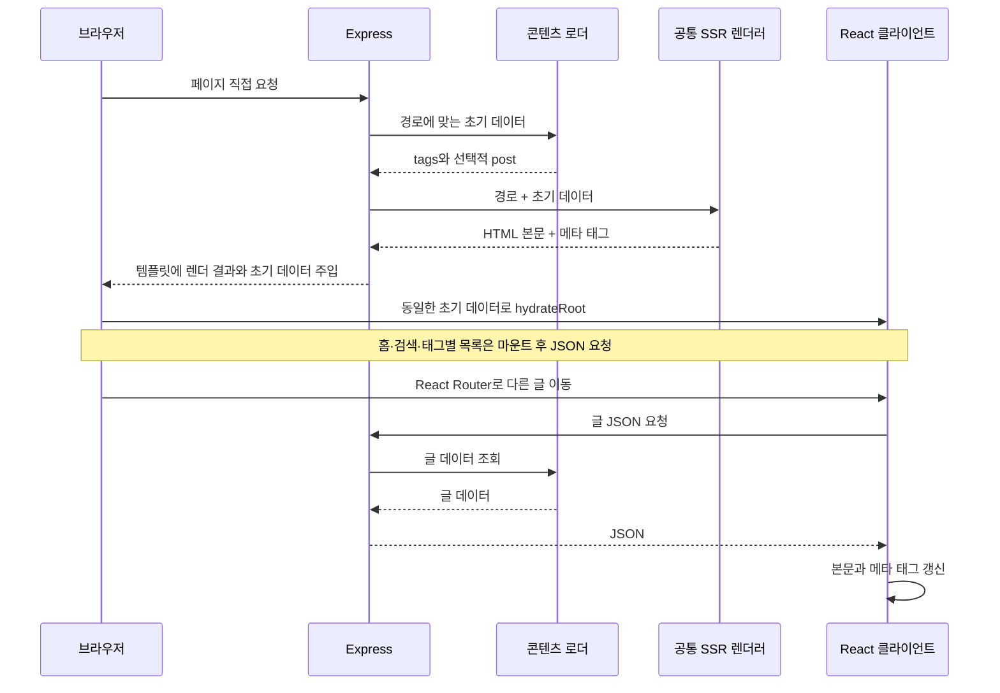

# Overview
빠른 개발을 위해 Express에서 요청 시점에 React를 렌더링하고, 초기 데이터를 담은 HTML을 브라우저의 hydration으로 연결한다.

# Checkpoint
- [공통 렌더러](../src/entry-server.tsx)는 `renderToPipeableStream`의 결과를 문자열로 모아 반환한다. Express의 HTTP 응답에 직접 스트리밍하지 않는다.
- [초기 데이터](../server/utils.ts)는 모든 페이지의 태그 집계와 글 상세의 `post`를 포함한다. 홈 목록·검색 데이터·선택한 태그의 글 목록은 브라우저에서 JSON을 요청하므로 전체 화면이 서버에서 완성되지는 않는다.
- [Mount Context](../src/context/Mount.tsx)는 초기 렌더링과 이후 탐색을 구분한다. 글 상세는 처음에는 주입 데이터를 사용하고, 이후에는 API를 요청한다. 메타 태그도 초기 HTML 생성과 클라이언트 갱신 경로가 나뉜다.
- 테마는 [HTML 초기 스크립트](../index.html)에서 복원하고 테마 버튼은 마운트 후 표시한다. Markdown·Giscus는 지연 로딩하며, Mermaid의 SVG 생성은 브라우저 effect에서 수행한다.
- 버전 맵이 포함된 프로덕션 HTML은 [클라이언트 진입점](../src/entry-client.tsx)에서 SW의 맵 저장 확인 뒤 hydration한다. 초기 HTML은 먼저 표시되지만 React 이벤트와 effect의 JSON 요청은 이 준비가 끝난 뒤 시작한다. 개발 환경은 이 대기를 생략하며, 실패·시간 제한은 [캐시 정책](ETag-Map.md)을 따른다.
- `npm run dev`는 Vite 미들웨어를 사용하는 SSR 환경이다. `npm run start:ssr`도 Express가 필요하므로 [SSG 배포](SSG.md)의 동작 검증을 대신하지 않는다.

# Diagram - 페이지 요청과 클라이언트 탐색
Express 환경에서 직접 URL 접근으로 HTML을 받는 과정과, hydration 이후 다른 글로 이동할 때 JSON을 요청하는 순서를 보여준다.

