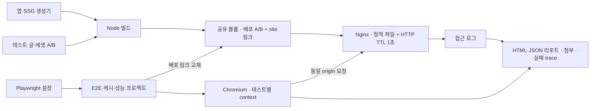

# Overview

[서버 유닛 테스트](../server/utils.test.ts)는 Node 내장 테스트 러너와 `tsx`로, 브라우저 테스트는 Docker의 Nginx와 Playwright Test로 실행한다.

테스트는 콘텐츠 검증·[SSG 생성](SSG.md)·사용자 동작·캐시 최신성·초기 동기화 비용을 다룬다.

# Checkpoints

자동 검사의 실행 정책과 환경별 보장 범위는 [설계 결정 문서](design-decisions.md)를 따른다. 이 문서는 테스트 입력·상태 제어·판정 근거와 실행 방법을 관리한다.

- 실제 게시글과 테스트 입력을 섞지 않는다. 임시 디렉터리와 fixture로 이름 검증·생성기·HTTP 동작을 검사하며, 브라우저 테스트의 배포 A/B도 테스트 전용 콘텐츠로 만든다. [유닛 입력](../server/utils.test.ts) · [fixture 빌드](../tests/Dockerfile)
- 캐시 적중은 `HIT-0-RTT`와 Nginx 요청 수를 함께 확인한다. SW를 거쳤다는 사실이나 짧은 소요 시간만으로 적중을 판정하지 않는다. [요청 기록 조회](../tests/support/static-site.ts)
- 배포 후 첫 접속의 판정은 추가 새로고침 전 응답·화면으로 한다. 뒤늦은 성공으로 최초 실패를 덮지 않도록 근거를 보관한다. [배포 갱신 테스트](../tests/cache/refresh.spec.ts)

# Diagrams



# Tests

## GitHub Actions와 로컬 검증

CI와 Docker는 Node 24를 사용한다. [앱 타입 검사](../tsconfig.app.json)는 서버 선언 파일이나 배포 빌드 없이 실행한다. 프로젝트 루트에서 다음 명령으로 CI와 같은 검사를 수행한다.

```bash
npm run test:app:typecheck
npm run test:unit:typecheck
npm run test:typecheck
npm run test:unit
```

## 서버 유닛 테스트

Node와 프로젝트 의존성이 설치된 환경에서 프로젝트 루트의 다음 명령으로 실행한다. 브라우저·Nginx·정적 배포 빌드는 필요하지 않다.

```bash
npm run test:unit:typecheck
npm run test:unit
```

- 실행 대상은 `server/*.test.ts`이며 기존 Playwright 명령과 독립적이다. [전용 타입 설정](../tsconfig.test.json)은 테스트가 가져오는 서버 코드와 별도 프로세스로 실행하는 Express 진입점도 검사하며 파일을 생성하지 않는다.
- [HTML 생성기](../server/gen-static.test.ts)와 [JSON 생성기](../server/gen-api-resource.test.ts)는 전달받은 입력과 임시 출력 경로로 산출물을 검사한다. 파일 시스템을 포함하는 통합 테스트이며 브라우저나 실제 콘텐츠 로더는 사용하지 않는다. 생성 모듈의 경계는 [SSG 문서](SSG.md#checkpoints)를 따른다.
- [버전 맵 주입 테스트](../server/inject-etag-map.test.ts)는 임시 산출물에 실제 주입 스크립트를 실행하고 삽입된 JavaScript를 평가해 키 보존을 검증한다. [SSR 통합 테스트](../server/server.test.ts)는 임시 프로젝트·테스트 글과 Express 개발 서버로 태그 API·초기 데이터 복원·쿼리 경계를 확인한다. 의존성은 기존 `node_modules`를 연결하며 실제 게시글은 복사하거나 읽지 않는다.
- [메타 유닛 테스트](../server/meta.test.ts)는 기본 메타데이터를 검사한다. 특수문자의 경계 보존은 [브라우저 테스트](../tests/e2e/metadata.spec.ts)에서 실제 생성 결과를 HTML로 파싱해 검증한다. 안전한 엔티티 표기가 여러 가지이므로 특정 문자열 표현을 정답으로 고정하지 않는다.
- `utils.ts`는 import 시 작업 디렉터리를 고정한다. 테스트 프로세스에서 임시 경로로 이동해 모듈을 로드한 뒤 원래 경로로 복구하고, 종료 시 임시 입력을 제거한다. 같은 모듈 인스턴스가 사용하는 입력을 테스트별로 초기화하므로 파일 안의 테스트는 순차 실행한다.
- 콘텐츠 검증은 목록·상세·초기 데이터·태그 집계의 각 경로에 같은 잘못된 입력과 실제 윤년 날짜를 전달해 확인한다. HTML 치환·직렬화는 삽입된 JavaScript를 평가해 복원 결과로 판정한다. [콘텐츠·직렬화 테스트](../server/utils.test.ts)

## 실행과 결과

프로젝트 루트에서 실행한다. 호스트에는 Docker가 필요하며 Node·Chromium은 컨테이너에서 실행한다. [Compose 설정](../compose.test.yaml)은 개발·정적 미리보기 서버와 별도 프로젝트를 사용한다.

```bash
# 정적 빌드와 타입 검사 후 E2E·캐시·성능 테스트 실행
docker compose -f compose.test.yaml up --build --renew-anon-volumes --force-recreate --abort-on-container-exit --exit-code-from test

# 컨테이너와 테스트 배포용 익명 볼륨 정리
docker compose -f compose.test.yaml down -v
```

종류별 실행은 테스트 서버를 새로 준비한 뒤 필요한 명령을 선택한다.

```bash
docker compose -f compose.test.yaml up --build -d --renew-anon-volumes --force-recreate static
docker compose -f compose.test.yaml run --build --rm test npm run test:e2e
docker compose -f compose.test.yaml run --build --rm test npm run test:cache
docker compose -f compose.test.yaml run --build --rm test npm run test:performance
```

- [러너 이미지](../tests/Dockerfile)를 빌드할 때 `npm run test:typecheck`로 테스트와 SW 초기화 모듈의 타입을 검사한다. 전체 앱의 타입 검사를 대신하지 않는다. `@playwright/test`와 Docker 이미지 버전은 함께 갱신한다.
- 실패하면 러너 종료 코드는 1이며 전체 실행 명령도 이를 전달한다. 리포트는 호스트의 `tests/artifacts/`에 남고 `down -v`로 지워지지 않는다. 같은 경로를 다음 실행에서도 사용하므로 비교할 결과는 재실행 전에 보관한다.
- HTML 리포트는 `tests/artifacts/report/index.html`, JSON은 `tests/artifacts/report.json`이다. 실패 trace·스크린샷은 `tests/artifacts/results/`에 남는다. Node 환경에서는 `npm run test:report`로 HTML 리포트를 제공할 수 있다. 산출물은 Git과 Docker 빌드 입력에서 제외한다.

## 테스트 범위

[정적 페이지 E2E](../tests/e2e/static-site.spec.ts)는 페이지네이션 경계의 비활성 이전·다음에 이동 주소가 없고 Tab 탐색에서 제외되는지, 활성 다음 링크는 Enter로 이동하는지 확인한다.

[Playwright 설정](../tests/playwright.config.ts)의 프로젝트별로 실행 대상을 구분한다. 새 테스트는 해당 디렉터리에 `*.spec.ts`로 추가한다.

| 위치 | 검증 대상 |
| --- | --- |
| [e2e](../tests/e2e/static-site.spec.ts) | SW를 차단한 글 직접 접속·SPA 탐색, 코드 블록·수식·Mermaid, 라이선스 정적 본문·새로고침·내부 이동, 정적 라우팅·조건부 요청·404 |
| [e2e/metadata.spec.ts](../tests/e2e/metadata.spec.ts) | 메타 생성 결과의 DOM 값·태그 수·속성 경계 보존 |
| [e2e/content-urls.spec.ts](../tests/e2e/content-urls.spec.ts) | 특수문자 태그의 실제 정적 JSON·링크·새로고침, 합성 목록 응답을 이용한 글 ID·상세 API·canonical 경계 |
| [e2e/request-failures.spec.ts](../tests/e2e/request-failures.spec.ts) | 응답 순서 역전·JSON 반환 지연·이전 요청 실패, 글 상세·홈·태그 목록의 실패 안내·시간 초과·재시도·타이머 정리, 빈 목록 성공, 검색 JSON 전체 성공·HTTP 오류·네트워크 실패·JSON 해석 실패 |
| [cache/refresh.spec.ts](../tests/cache/refresh.spec.ts) | SW 허용/차단 × 일반/느린 이미지 로딩에서 배포 후 첫 접속의 목록과 캐시 재사용 |
| [cache/bootstrap.spec.ts](../tests/cache/bootstrap.spec.ts) | 검색·태그 직접 접속, SW 미지원·등록 실패, 맵 저장 실패 응답·확인 응답 유실 |
| [cache/client-maps.spec.ts](../tests/cache/client-maps.spec.ts) | 문서 간 맵 격리, SW 재시작 후 맵 유지, 맵 누락 시 네트워크 요청, 종료된 문서와 이전 전역 맵 정리 |
| [cache/upgrade.spec.ts](../tests/cache/upgrade.spec.ts) | 과거 전역 맵 SW의 실제 설치·업데이트 지연 및 실패, 미지원 ACK 우회, controller 전환 중 맵 저장 대기·시간 초과·늦은 ACK, 전환 후 재시작 |
| [performance](../tests/performance/bootstrap.spec.ts) | SW 미지원 기준선·최초 설치·캐시 준비 후 재방문·등록 지연 실패의 로컬 측정 |
| [fixtures](../tests/fixtures) · [support](../tests/support/static-site.ts) | 두 배포의 입력과 배포 링크 교체·버전 맵·Nginx 로그 조회 |

## 배포와 캐시 격리

- A는 기존 글 하나를 포함하고, B는 기존 글을 유지하면서 새 글과 변경된 SVG를 추가한다. 둘을 미리 전체 빌드해 두고 `/srv/site` 심볼릭 링크만 원자적으로 교체한다. 이전 산출물은 프로젝트 밖에 보관해 다음 Tailwind 소스 탐색에 섞이지 않게 한다.
- A·B의 앱 번들과 SW는 같아야 하고 JSON·테스트 SVG의 버전은 달라야 한다. SVG는 [버전 판정 정책](design-decisions.md#수용한-트레이드오프)에 맞춰 크기도 바꾼다. SW 스크립트 업그레이드는 별도 시나리오로 검사한다.
- 업그레이드 테스트는 이와 별도로 [과거 워커](../tests/fixtures/sw-global.js)를 A의 `/sw.js`로 제공한다. fixture는 `3716b81047a2be592495978a449158ba83590b97`의 `public/sw.js` 원문이며, 전역 맵·버전 없는 ACK·API 우회를 지원한다. B에서는 현재 워커의 install 완료를 보류하거나 실패시켜 실제 브라우저의 업데이트와 제어권 전환을 검사한다. 테스트 종료 시 두 배포의 워커 파일을 복원한다.
- 각 테스트는 배포 A와 새 browser context에서 시작한다. 기존 갱신 테스트는 배포 전환 중 탭만 닫고 같은 context에서 새 탭으로 접속하여 SW·Cache Storage·HTTP 캐시를 유지한다. 문서별 맵 테스트는 같은 context에 이전 문서와 새 문서를 함께 열어 맵 재전송 순서를 제어한다. `--renew-anon-volumes`는 재실행 시 이전 빌드가 담긴 서버 볼륨이 재사용되는 것을 막는다.
- Nginx는 [공통 정적 서버 설정](../nginx/default.conf.template)과 HTTP TTL 1초를 사용한다. 브라우저와 Nginx는 네트워크를 공유하여 같은 `http://localhost`에 접속하며, 러너는 배포 볼륨으로만 전환을 제어한다. Docker 소켓이나 관리 API는 사용하지 않는다.

## 재현 조건과 판정

- 파일명 검증은 임시 콘텐츠와 직접 검증 입력으로 수행해 Windows에서 만들 수 없는 이름도 같은 정책으로 검사한다. 실제 게시글 본문은 읽지 않는다. 글 ID의 HTML·JSON 파일명 보존은 생성기 테스트로, 태그의 실제 HTTP 요청은 fixture의 `C++`·`C#`·`R&D`·한글·공백·`%`로 확인한다.
- [태그 URL E2E](../tests/e2e/content-urls.spec.ts)는 정적 직접 접속·새로고침에서 hydration 경고와 복구 오류가 없고, 특수문자 선택과 JSON 조회가 유지되는지 검사한다. 합성 목록으로 `page=2` 직접 접속·새로고침, 태그 변경·선택 해제·뒤로 가기도 검증한다. 초기 선택값과 URL 적용 시점은 [환경별 정책](design-decisions.md#설계-전제와-정책)을 기준으로 판정한다.
- SSR 쿼리 처리는 테스트용 글을 넣은 Express 개발 서버에 직접 접속해 확인한다. 글의 쿼리 포함 URL, `/tags?tag=posts`, `/?page=2`에서 HTTP 응답과 원본 HTML의 본문·제목·canonical을 확인하고, 브라우저에서 태그 선택과 페이지 번호도 확인한다. 기존 Nginx E2E의 대상은 SSG 산출물이다.
- 요청 실패 E2E는 SW를 차단하고 API 응답을 제어한다. 이전 응답을 보류한 상태에서 현재 경로의 결과가 먼저 표시된 것을 확인한 뒤 이전 응답을 해제한다. 응답 취소도 허용하며, 취소하지 않는 구현에서는 늦은 응답이 화면과 글 메타데이터를 덮지 않아야 한다. 글 경로 간 전환은 `popstate`로 같은 React 루트에서 재현한다.
- `json()` 반환 지연은 본문을 읽은 뒤 결과 전달만 보류해, 네트워크 취소만으로 막을 수 없는 오래된 결과 반영을 검사한다. 이전 요청이 실패해도 현재 요청의 로딩 표시를 종료해서는 안 되며, 글 화면을 떠난 뒤에는 이전 응답이 다른 화면의 메타데이터를 변경해서는 안 된다. 글 직접 접속은 상세 API를 차단한 채 hydration과 사용자 입력을 확인해 초기 데이터 경로도 보호한다.
- 요청 대기 상한은 Playwright Clock으로 응답 대기·JSON 결과 전달 지연·요청 교체·성공 후의 타이머 정리를 각각 제어해 검사한다. HTTP·네트워크·JSON 해석 실패와 빈 목록 성공을 구분하고, 홈 첫 요청과 재시도도 포함한다. 기대 동작은 [요청 실패 정책](design-decisions.md#지원-범위와-알려진-제약)을 따른다.
- 검색은 일부 페이지 실패와 전체 성공을 각각 주입하고, 전체 성공 시 후속 페이지의 글도 검색되는지 확인한다. API 응답을 제어하는 이 검사는 실제 HTTP·SW 캐시 적중 판정과 구분한다.
- `cache-probe.svg`는 같은 URL의 이미지 내용 갱신을 확인하는 에셋이다. 썸네일 표시 검증이 아니며, 새 맵 반영 이후 fetch한 본문과 캐시 재사용을 확인한다.
- `cache-load-gate.svg`는 `load` 이벤트를 늦추는 장치다. B 문서에 숨긴 eager 이미지를 삽입하고 [Nginx](../tests/nginx-delay.conf)에서 해당 응답만 초당 256바이트로 제한한다. 고유 query로 이전 이미지 캐시를 피한다. 자연 접속 결과와 이 통제 조건의 결과를 구분하며, 특정 실사이트 이미지가 원인이었다고 단정하지 않는다.
- 일반 갱신 시나리오는 HTTP TTL 경과를 기다린 뒤 접속하며 HTTP 캐시를 지우거나 요청을 모킹하지 않는다. 검색·태그 직접 접속 검증은 TTL 대기 없이 배포를 전환해 HTTP 재검증 경로도 확인한다. 오류 조건은 초기 스크립트에서 SW API 동작을 주입한다.
- 캐시 준비는 controller·맵·저장 응답 상태로 기다린다.
- 첫 접속의 새 글 표시에는 `expect.soft`를 사용한다. 실패 상태를 유지한 채 맵 반영 뒤 에셋 갱신과 추가 새로고침 결과까지 수집하기 위한 것이다. 나중의 새로고침 성공으로 최초 실패를 덮지 않는다.
- 리포트의 `cache-evidence`에는 실제 첫 목록 응답과 문서/SW/캐시 버전, `nginx-access`에는 서버 요청 기록이 들어간다. `first-visit` 이미지는 추가 새로고침 전 화면이다. 실패 시 자동 스크린샷은 진단용 새로고침 이후일 수도 있으므로 첫 접속 판정에는 해당 첨부를 사용한다.
- 문서별 맵 테스트는 같은 URL로 연 두 문서에서 B 문서의 저장 확인 이후 A 문서가 맵을 다시 전송해도 B 목록을 요청하는지 검사한다. 맵 진단은 SW의 클라이언트 목록에서 문서 URL에 대응하는 ID를 조회하므로, 해당 진단을 사용하는 테스트는 문서 URL을 구분한다. SW 재시작은 Chromium의 `ServiceWorker.stopWorker`와 `stopped` 상태 확인으로 재현하고 맵 재전송 없이 캐시 적중과 서버 요청 수를 확인한다.
- 업그레이드는 같은 context에서 A 문서와 SW·응답 캐시를 유지한 채 B 문서를 연다. A 캐시는 원래 fetch로 채우고, B의 첫 목록 요청만 보류해 B의 실제 ACK 이후 A 맵을 재전송한다. API 응답은 모킹하지 않는다. 새 워커의 install 대기와 문서의 controller 동일성을 따로 확인하고, 전환 후에는 실제 맵 저장을 보류해 ACK 전 API 우회도 검사한다. 맵 저장 시간 초과는 실제 2초 상한을 넘겨 기다린 뒤 ACK를 전달한다. `upgrade-before-control-change`에는 초기 표시·ACK·응답·서버 요청 수를, 후속 첨부에는 저장 대기와 재시작 결과를 남긴다. 기존 A/B 테스트만으로는 워커 업그레이드를 검증할 수 없다.

## 성능 측정

지표와 결과의 해석 범위는 [설계 결정의 검증 범위](design-decisions.md#검증-범위와-해석)를 따른다.

- 각 조건을 5회 측정하고 `bootstrap-performance`에 원시 표본과 중앙값·최솟값·최댓값을 첨부한다. 재방문은 첫 설치와 제어된 방문으로 캐시를 채운 뒤 HTTP TTL이 지난 상태에서 측정한다.
- 등록이 끝나지 않는 조건은 완료되지 않는 Promise를 주입해 동기화 대기 상한의 비용을 측정한다.
- FCP·캐시 동기화·hydration 호출·테마 버튼 마운트·목록 DOM 표시를 따로 수집하고 테마 버튼 클릭도 확인한다. 원시 표본과 단계별 시점을 함께 보관한다.
