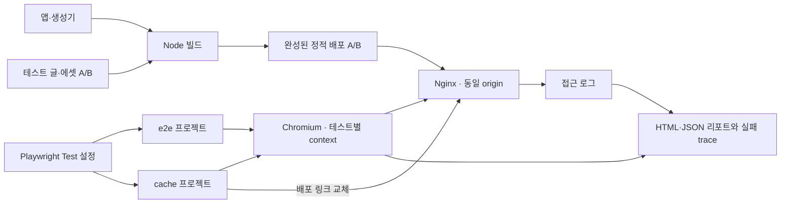

# Overview

프로젝트의 브라우저 테스트를 TypeScript와 Playwright Test로 실행한다. `e2e/`는 사용자 탐색과 정적 서버 계약, `cache/`는 SW 캐시와 배포 후 최신성, `performance/`는 루트 동기화의 로컬 비용을 검증한다.

# Checkpoint

프로젝트 루트에서 실행한다. Node·Chromium·빌드 도구는 Docker 안에서 실행하므로 호스트에 설치할 필요가 없다.

```bash
# 테스트용 빌드, TypeScript 검사, E2E·캐시 테스트
docker compose -f compose.test.yaml up --build --renew-anon-volumes --force-recreate --abort-on-container-exit --exit-code-from test

# 이번 테스트의 컨테이너와 배포용 익명 볼륨 정리
docker compose -f compose.test.yaml down -v
```

종류별로 실행하려면 테스트 서버를 새로 준비한 뒤 러너 명령을 선택한다.

```bash
docker compose -f compose.test.yaml up --build -d --renew-anon-volumes --force-recreate static
docker compose -f compose.test.yaml run --build --rm test npm run test:e2e
docker compose -f compose.test.yaml run --build --rm test npm run test:cache
docker compose -f compose.test.yaml run --build --rm test npm run test:performance
```

| 위치 | 역할 |
| --- | --- |
| `e2e/*.spec.ts` | 글 직접 접속·SPA 탐색, 정적 라우팅·조건부 요청·404 |
| `cache/*.spec.ts` | SW 허용/차단 × 일반/느린 이미지 로딩의 배포 갱신 시나리오 |
| `performance/*.spec.ts` | SW 미지원 기준선·최초 방문·캐시 준비 후 재방문·등록 지연 실패에서 각각 5회 측정 |
| `fixtures/` | A의 기존 글·SVG와 B에 추가할 새 글·변경 SVG |
| `support/static-site.ts` | 테스트 배포 선택, 버전 맵과 서버 로그 조회 |
| `playwright.config.ts` | 프로젝트별 실행 범위, 격리·리포트·trace 설정 |
| `artifacts/` | 생성된 HTML·JSON 리포트, 첨부 증거, 실패 trace·스크린샷 |

- 실제 `content/posts`를 복사하지 않고 현재 앱·생성기에 fixture만 입력한다. A·B는 동일한 앱 번들과 SW를 유지하며, 같은 URL의 JSON·SVG 버전은 달라야 한다. SVG 크기도 바꿔 현재 파일명·크기 기반 버전 정책과 충돌하지 않게 한다.
- Nginx는 기존 정적 서버 템플릿과 HTTP TTL 1초를 사용한다. 테스트 러너는 Nginx의 네트워크와 배포 볼륨을 공유하여 `http://localhost`에 접속한다. Docker 소켓이나 별도 관리 API는 필요하지 않다.
- 각 테스트는 새 browser context와 배포 A로 시작한다. A→B 전환에서는 context와 캐시를 유지하고 탭만 닫는다. 완성된 배포 링크를 원자적으로 바꾸며, 재실행 시 익명 볼륨을 갱신해 이전 빌드가 남지 않게 한다.
- 공유 배포 링크 때문에 `workers: 1`로 실행한다. 병렬 실행을 추가하려면 먼저 worker별 서버·배포 볼륨을 분리해야 한다. 재시도는 최초 접속 실패를 가릴 수 있어 끈다.
- 캐시 준비는 controller·맵·저장 응답 상태로 기다린다. HTTP TTL이 지난 뒤에도 `HIT-0-RTT`이며 Nginx 요청 수가 늘지 않는지 확인한다. HTTP 캐시를 지우거나 요청을 모킹하지 않는다.
- 느린 이미지 조건은 B 문서에 eager 테스트 이미지를 삽입하고 Nginx에서 해당 응답만 초당 256바이트로 제한한다. 고유 query로 이전 이미지 캐시를 피한다. 자연 접속 결과와 이 통제 조건의 결과는 구분해야 한다.
- 첫 접속의 새 글 표시 검증에는 `expect.soft`를 사용한다. 실패 상태를 유지하면서 맵 반영 뒤 SVG 갱신과 추가 새로고침 결과를 진단한다. 알려진 문제를 `skip`·`xfail`로 숨기지 않으며, 실패가 있으면 종료 코드 1을 반환한다. SVG 검증은 맵 반영 이후의 동작이며 초기 에셋 전체의 최신성이나 성능 개선율을 검증하지 않는다.
- Playwright가 테스트 격리와 결과 집계를 담당한다. HTML 리포트는 `artifacts/report/index.html`, JSON은 `artifacts/report.json`에 저장한다. 캐시 테스트의 `cache-evidence` 첨부에는 첫 응답·문서/SW/캐시 버전이, `nginx-access`에는 서버 요청 기록이 들어간다. `first-visit` 스크린샷은 추가 새로고침 전에 저장하며 실패 trace도 남긴다.
- `cache/bootstrap.spec.ts`는 검색·태그 직접 접속, SW 미지원·등록 실패, ACK 유실·저장 실패 응답을 확인한다. 오류 조건은 초기 스크립트에서 주입하며 실제 HTTP 요청을 모킹하지 않는다.
- 성능 측정은 캐시 준비 대기, FCP, 테마 버튼 마운트, 목록 DOM 표시의 중앙값·최솟값·최댓값을 첨부한다. 테마 버튼 클릭도 검증한다. 로컬 Nginx·Chromium에서의 소수 표본이며 외부 폰트 로딩과 실행 환경에 영향을 받으므로 실제 GitHub Pages의 개선율이나 상한을 의미하지 않는다.
- `npm run test:typecheck`는 테스트 코드와 새 SW 초기화 모듈을 검사하며 러너 이미지 빌드에도 포함된다. `@playwright/test`와 `Dockerfile`의 Playwright 이미지 버전은 함께 갱신한다. Node 환경에서는 `npm run test:report`로 저장된 HTML 리포트를 열 수 있다.

# Architecture


